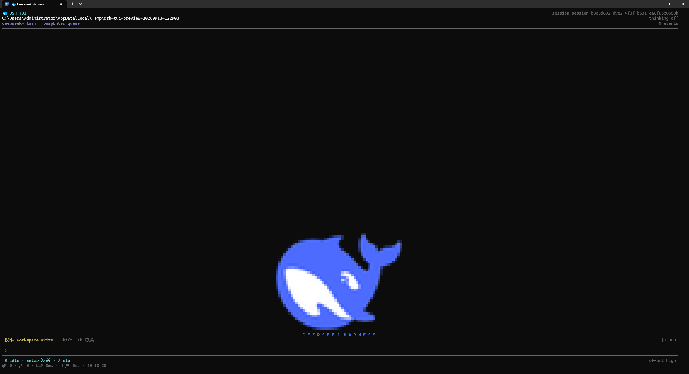
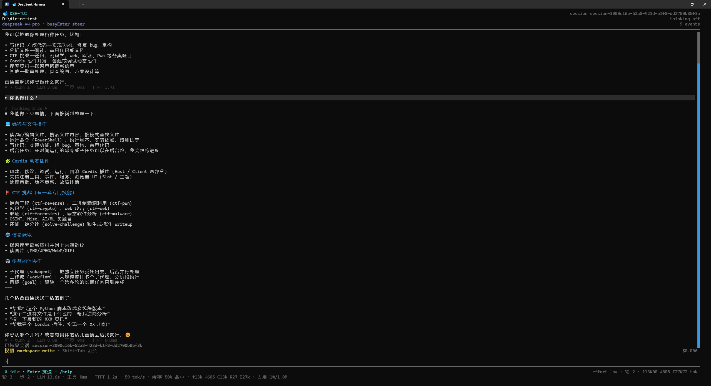

# DSH Terminal UI (`dsh-tui`)

English | [中文](README.zh.md)

Unofficial terminal UI for DeepSeek Harness.

<p align="center">
  <a href="#quick-start"></a>
  <a href="https://www.npmjs.com/package/@jame100101/dsh-tui/v/0.2.2"></a>
  <a href="#architecture"></a>
  <a href="#architecture"></a>
  <a href="#architecture"></a>
  <a href="#key-features"></a>
</p>

<p align="center">Local-first · Session persistence · Tool runtime</p>

> **Unpublished development branch**: local builds target exact official Harness `0.2.1-rc.2`. Published npm `0.2.2` targets the previous host and does not contain this work. Use the local tarball in [isolated installation and validation](README.md#isolated-development); the default npm `0.2.0-rc.2` channel is a separate untested version.

These are reference screenshots from an earlier release, not acceptance screenshots of this branch.

<p align="center">
  
  
</p>

`dsh-tui` is a **local terminal assistant** for the DeepSeek Harness agent runtime — a Claude Code-style CLI with a React 19 + Ink 7 interface: thinking shimmer, streaming replies, tool cards, permissions, slash-command palette, persistent sessions, and settings panels.

<a id="run"></a>

## Quick Start

### 1. Install Node.js and npm

The package requires the repository's exact engine range: `^22.19.0 || >=24.0.0`. This means Node.js 22.19.0 or newer within Node 22, Node.js 24 or newer, and later releases that satisfy `>=24`. Node 23 and early Node 22 releases are outside the declared range.

npm is normally installed together with the official Node.js distribution; it does not need a separate download. First check your current environment:

```sh
node --version
npm --version
```

Use one of these platform-specific installation paths if either command is missing or the version is outside the supported range.

#### Windows

**Option A — official installer**

Download a current Node.js installer from [nodejs.org](https://nodejs.org/en/download) and choose a release that satisfies Node 22.19+ or Node 24+. The official installer includes npm.

**Option B — winget**

```powershell
winget install OpenJS.NodeJS.LTS
```

Close and reopen PowerShell or Windows Terminal after installation, then verify:

```powershell
node --version
npm --version
where.exe node
where.exe npm
```

#### macOS

With [Homebrew](https://brew.sh/) installed:

```sh
brew install node
node --version
npm --version
```

If an older Node.js is already installed, upgrade it to a version in `^22.19.0 || >=24.0.0`. Developers who switch between projects can use [nvm](https://github.com/nvm-sh/nvm):

```sh
nvm install 24
nvm alias default 24
nvm use 24
node --version
npm --version
```

#### Ubuntu / Debian

The distribution's default apt repository may provide an older Node.js. Seeing a working `node` command is not enough; check the version before installing `dsh-tui`.

One copyable NodeSource setup for Node 24 is:

```sh
sudo apt-get update
sudo apt-get install -y ca-certificates curl
curl -fsSL https://deb.nodesource.com/setup_24.x | sudo -E bash -
sudo apt-get install -y nodejs

node --version
npm --version
which node
which npm
```

For development machines, nvm is a user-level alternative that avoids system-wide npm permissions:

```sh
sudo apt-get update
sudo apt-get install -y curl
curl -o- https://raw.githubusercontent.com/nvm-sh/nvm/v0.40.6/install.sh | bash
source ~/.bashrc
nvm install 24
nvm alias default 24
nvm use 24

node --version
npm --version
which node
which npm
```

Use `source ~/.zshrc` instead when the login shell is zsh. If the host already has an older apt or system Node.js, upgrade or select a supported version before continuing.

### 2. Install the local development tarball

Follow [isolated installation and validation](README.md#isolated-development) to build, install the exact official host, and add the local tarball. All evaluation uses a new temporary directory and separate `DSH_HOME`, without upgrading a global installation or touching production sessions.

The unpublished package version is `0.3.0-rc.1`; npm `0.2.2` remains the previous release. The profile composes official `@deepseek-ai/dsh-base` with local `@jame100101/dsh-tui`; the optional thin launcher is not automatically added to shell PATH.

### 3. Start a project

The `dsh` examples below refer to the isolated official executable. Use its full path and temporary `DSH_HOME` from the validation guide when evaluating this branch.

Run the `tui` profile from the directory you want to use as the workspace. The current directory is the default workspace:

```sh
cd your-project
dsh --profile tui
```

Set your DeepSeek API key before starting. Bash, zsh, and PowerShell examples:

```sh
export DEEPSEEK_API_KEY=your_api_key
dsh --profile tui
```

```powershell
$env:DEEPSEEK_API_KEY = "your_api_key"
dsh --profile tui
```

Keep API keys out of source files and shell history where practical.

You can also enter a credential inside the TUI:

1. Type `/settings`, then press `Tab` to open the **Models** page.
2. Under **API credentials**, select the DeepSeek credential and press **Enter**.
3. Type the key (the field is masked and never echoed) and press **Enter** to confirm.

Credentials remain in the selected `$DSH_HOME`. The official base policy prefers managed credentials before environment and `.env` fallbacks. The UI displays value-free source metadata. Isolated official-service tests verify managed-file, process, project-environment and user-environment precedence; real accounts and unknown secret formats still require separate validation.

## Common Commands

| Command | Purpose |
| --- | --- |
| `dsh --profile tui` | Start the TUI in the current directory. |
| `dsh --profile tui "<task>"` | Start the TUI and submit a task immediately. |
| `dsh --profile tui -c` / `--continue` | Resume the newest session from the current directory. |
| `dsh --profile tui -r` | Open the interactive session picker. |
| `dsh --profile tui -r <session-id>` | Resume a session by id, id prefix, or title. |
| `dsh --profile tui -c --fork-session` | Fork a resumed session at its last completed turn. |
| `dsh --profile tui -p "<task>"` | Print one task result to stdout without opening the TUI. |
| `dsh --profile tui -c -p "<task>"` | Resume a session, then run one task non-interactively. |
| `dsh --profile tui --version` | Print the compatible official TUI host version. |
| `dsh --profile tui --help` | Show CLI options. |
| `/help` | Show interactive commands inside the TUI. |
| `/new` | Create a new session. |
| `/resume` | Browse and resume a saved session. |
| `/settings` / `/config` | Open settings (`/config` is an alias). |
| `/jobs` / `/tasks` | Inspect owner-scoped background jobs (`/tasks` is only a jobs alias). |
| `/export` | Export the retained, masked display projection as text. |
| `/export --raw` | Explicitly export the complete raw host session ZIP; it can contain sensitive data. |
| `Ctrl+R` | Search input history; Escape restores the draft. |
| `@path` | Complete a workspace file reference at the cursor, including inside a sentence. |
| `/keymap legacy-dsh` / `/keymap claude-fullscreen` | Explicit keyboard migration; existing profiles retain legacy defaults. |
| `Ctrl+L` | Redraw while preserving the draft; two presses within 2s create a session in Claude keymap. |
| `/clear` / `/clear-screen` | Start a session / redraw only; both preserve the input draft. |
| `/source [callId]` | Page complete masked tool records; n/p pages, e exports. |
| `/session-source` | Inspect complete masked session records, including evicted display rows. |
| `/send-child <id> queue\|steer <text>` | Send human input to a continuable direct child; receipt means inbox acceptance only. |
| `Ctrl+Z` (POSIX) | Return the terminal and suspend; shell `fg` restores the draft. |
| `Ctrl+_` / `Alt+U` | Undo / redo complete draft snapshots; `/draft undo` and `/draft redo` are alternatives. |
| `Alt+B/F`, `Ctrl+Left/Right` | Move by word without splitting graphemes. |
| `Ctrl+W`, `Alt+Backspace`, `Ctrl+U/K`, `Ctrl+Y` | Delete a word or line segment; restore the deletion buffer (`/draft yank`). |
| `/editor` | Edit the draft with explicitly configured VISUAL or EDITOR; GUI editors need a wait flag. |
| `/effort` | Select the thinking effort. |
| `Ctrl+C` twice | Exit the TUI. |

Display masking uses a limited set of patterns. It is not a guarantee that every secret is removed, and it does not modify the host's persisted history. Review exports before sharing. The default text export contains only retained display rows; use the explicit raw option only when a complete host archive is needed. Feature availability here does not mean all F01–F35 or terminal acceptance cases have passed.

The Plugins settings page accepts an exact version and a second confirmation for profile-owned third-party bundles. Official pending-restart results keep installed and loaded versions separate; unsupported HMR replacement reports the actual failure. Set `DSH_TUI_REDUCED_MOTION=1` to disable decorative animation; `TERM=dumb` also enables this mode.

Exit codes: `0` means success, `1` a runtime failure, `2` a usage error, and `130` SIGINT. `--print` writes only the assistant result to stdout; diagnostics go to stderr.

## Key Features

- **Local-first TUI:** runs in your terminal instead of a hosted web page.
- **Streaming agent interaction:** shows thinking, replies, tool activity, permissions, and status as they arrive.
- **Persistent sessions:** resume prior conversations, browse history, rename sessions, and fork without overwriting the original.
- **Print mode:** `-p` produces clean, scriptable output for shells and CI.
- **Slash-command palette:** type `/` to search available commands; `Tab` completes and `Esc` dismisses.
- **Settings:** General, Models with API credentials, Plugins, Inventory, and agent Presets pages.
- **Tools and permissions:** bash, PowerShell, file, and web tools use a sandbox-mode bar with approval and ask-user interactions.
- **Responsive terminal layout:** handles resize, alternate-screen lifecycle, mouse wheel, selection, and scrollbar interaction.
- **Unicode-aware display:** supports CJK text, emoji, and symbols such as ⚙ in composer and transcript layout.
- **Persistent shell startup:** the official Harness uses one shared prompt sentinel between the persistent shell tool and its terminal reader, so short commands such as `pwd` and `ls` do not wait for a mismatched-prompt fallback timeout.
- **Plugin distribution:** the TUI installs as a profile bundle over the compatible official Harness instead of copying its runtime.

## Troubleshooting

### Existing installations and rollback

Keep the previous host, plugin and original `DSH_HOME`. This branch uses a parallel isolated installation; it does not require uninstalling global packages, rebuilding a production profile or migrating old sessions. See the [validation guide](README.md#isolated-development) for rollback and data handling.

### `node: command not found` or Windows says `'node' is not recognized`

Reopen the terminal after installing Node.js. If the problem remains, verify that Node.js is installed and that its installation directory is on `PATH`:

```sh
which node
which npm
```

On Windows use:

```powershell
where.exe node
where.exe npm
```

### `npm: command not found`

npm is normally supplied by the Node.js installation. Repair or reinstall Node.js and its PATH entry instead of downloading npm separately.

### `dsh: command not found`

Check the global npm prefix and the executable locations:

```sh
npm prefix -g
which node
which npm
which dsh
```

On Windows:

```powershell
npm prefix -g
where.exe node
where.exe npm
where.exe dsh
```

If the global bin directory is not on PATH, add the directory reported by your npm installation or use a user-level Node manager such as nvm.

### `dsh-tui: command not found`

This is expected after `dsh plugin --profile tui add`: the plugin manager keeps the package bin inside the profile and does not expose it on the shell `PATH`. Launch with `dsh --profile tui`.

### Node.js version is too old

Run `node --version` and upgrade to the declared range `^22.19.0 || >=24.0.0`. Node 22.0–22.18 and Node 23 are not part of this package's supported engine range.

### Linux or macOS global install reports EACCES

Prefer nvm or another user-level Node.js installation so npm's global prefix is writable by your account. Do not make `sudo npm install -g ...` the default fix; it can create mixed ownership in the npm prefix.

## Release status and maintenance

This branch is unpublished and unmerged; it changes no npm dist-tag or GitHub Release. Published `0.2.2` and the local development package are not interchangeable; the new candidate has a separate version and filename. Evaluate the exact tarball instead of npm `latest`.

The official host owns sessions, credentials and configuration. Do not delete the production home or automatically rebuild it with `--from-default-profile`. See the [development validation guide](README.md#isolated-development) for sources, versions, rollback and manual coverage limits.

## Development

<a id="run-from-source"></a>

This is a standalone out-of-tree plugin repo. It no longer vendors or synchronizes full Harness source. Future Harness updates use dependency upgrades plus adapter compatibility tests, not upstream merges.

```sh
git clone https://github.com/jame100101/dsh-terminal-ui.git
cd dsh-terminal-ui
pnpm install --frozen-lockfile
pnpm run build
pnpm run typecheck
pnpm run test
pnpm run verify:repo
pnpm run test:docs
pnpm run dsh-tui:pack-plugin
```

TUI source lives in `packages/tui/tui`; `apps/tui-cli` owns the thin launcher, bundle patch, packaging and official clean-room verifier. Validate the local tarball through official dsh rather than a repository-local Harness CLI. Maintain English and Chinese docs together.

## Architecture

- **React 19 + Ink 7:** terminal rendering and input handling.
- **TypeScript:** typed application and plugin code.
- **DeepSeek Harness runtime:** plugin-based services for sessions, tools, permissions, persistence, and agent loops.
- **Persistent terminal tools:** shell and filesystem operations run through the Harness runtime.
- **Session storage:** local persistence supports resume and history browsing.

```text
dsh-tui (CLI wrapper, apps/tui-cli)
  → official @deepseek-ai/dsh launcher
  → Cordis plugin composition (profile: tui)
  → React + patched Ink TUI plugin (@jame100101/dsh-tui)
  → event-sourced session log → live transcript rows
```

The wrapper translates launch flags and starts `dsh --profile tui`. The TUI plugin folds the append-only session log into transcript rows for users, assistant messages, thinking, tool cards, retries, and status, then chooses the patched Ink full-screen renderer for TTYs or a line-driven fallback for pipes and CI.

For a feature-by-feature comparison with the Web frontend, see **[TUI-WEB-COMPARISON.md](TUI-WEB-COMPARISON.md)**.

See [docs/architecture.md](docs/architecture.md) for plugin architecture.

<a id="isolated-development"></a>

## Isolated development

This branch is unpublished. Its unpublished candidate version is `0.3.0-rc.1`; the npm `@jame100101/dsh-tui@0.2.2` release is a different artifact for Harness `0.1.5-rc.3`. Use the local tarball below with exact official Harness `0.2.1-rc.2`. Use the pinned version rather than a mutable npm tag.

## Preferred ongoing source acceptance

Reuse an existing isolated acceptance home instead of creating a new one for every revision:

```sh
DSH_TUI_ACCEPTANCE_HOME=/absolute/existing/isolated/home pnpm dev:tui
```

This builds the checkout against pinned rc.2, seeds a separate `tui-source` profile once, and keeps the same credentials and sessions. It requires an existing `tui` profile and does not change the global installation. Existing source profiles must point to this checkout; foreign or dangling source links are rejected before any build or profile write. Keep the owning checkout when reusing a source profile. Stop it before using the previous launcher for rollback. On macOS Terminal, paste screenshots with **Ctrl+V**; Cmd+V may send no input event. See the feature comparison and limitations (review records are stored outside Git).

## Build and automated checks

Run from this checkout with Node `^22.19.0 || >=24.0.0` and pnpm `11.7.0`:

```sh
# Run in your checkout.
cd /path/to/dsh-terminal-ui
pnpm install --frozen-lockfile
pnpm build
pnpm typecheck
pnpm test
pnpm verify:repo
pnpm test:docs
pnpm dsh-tui:pack-plugin
pnpm audit:tarball apps/tui-cli/jame100101-dsh-tui-0.3.0-rc.1.tgz
pnpm dsh-tui:verify-plugin apps/tui-cli/jame100101-dsh-tui-0.3.0-rc.1.tgz
```

Run the native integration suite in an environment that permits PTYs, loopback listeners and the official OS sandbox. A nested execution sandbox may reject these operations; reproduce that failure outside the outer sandbox while retaining the Harness policy. Do not disable approval or sandbox checks to make tests pass. Render fixtures wait for Ink output completion; PTY tests observe the target screen state before sending dependent keys.

The verifier creates a separate official installation and `DSH_HOME`, installs the exact tarball, boots three PTY launcher paths and verifies shared Harness/Cordis identities, patched Ink, and one React runtime. It retains its temporary directories and reports their locations. These checks establish packaging and startup; they do not certify real provider requests, real account authorization or every terminal environment. Use implementation progress (review records are stored outside Git) for executed evidence, PASS/FAIL/UNTESTED and remaining acceptance gaps.

## Interactive evaluation on macOS or Linux

Run the following from the checkout after packing. It installs only into a new temporary directory, without changing global Harness or the production home:

```sh
DSH_VALIDATION_TARBALL="$(pwd)/apps/tui-cli/jame100101-dsh-tui-0.3.0-rc.1.tgz"
DSH_VALIDATION_DIR="$(mktemp -d -t dsh-tui-eval.XXXXXX)"
mkdir -p "$DSH_VALIDATION_DIR/host"
node -e 'require("fs").writeFileSync(process.argv[1],JSON.stringify({private:true,overrides:require("./scripts/security-overrides.json")}))' "$DSH_VALIDATION_DIR/host/package.json"
npm install --prefix "$DSH_VALIDATION_DIR/host" --save-exact --no-audit --no-fund @deepseek-ai/dsh@0.2.1-rc.2
DSH_HOME="$DSH_VALIDATION_DIR/home" "$DSH_VALIDATION_DIR/host/node_modules/.bin/dsh" plugin --profile tui add "$DSH_VALIDATION_TARBALL"
NODE_ENV=production DSH_HOME="$DSH_VALIDATION_DIR/home" "$DSH_VALIDATION_DIR/host/node_modules/.bin/dsh" --profile tui
```

To evaluate another project, change to its directory and repeat the final command using the same variables. Relative `@file` and image paths follow the session's effective working directory. Changing the session directory does not change the original project identity, existing shell process directories or writable sandbox roots.

Configure a test credential through the Models settings page or an inherited environment variable. Do not paste real keys into reports, screenshots or shell command history. This TUI uses official base credential policy: managed credentials precede environment and `.env` fallbacks. Settings show the source reported by the host; the official local-provider source-precedence combinations are covered by isolated automated tests.

## Windows PowerShell

After packing from the checkout:

```powershell
$dshValidationTarball = (Resolve-Path 'apps/tui-cli/jame100101-dsh-tui-0.3.0-rc.1.tgz').Path
$dshValidationDir = Join-Path ([IO.Path]::GetTempPath()) ('dsh-tui-eval-' + [guid]::NewGuid().ToString('N'))
New-Item -ItemType Directory -Path $dshValidationDir | Out-Null
New-Item -ItemType Directory -Path (Join-Path $dshValidationDir 'host') | Out-Null
node -e 'require("fs").writeFileSync(process.argv[1],JSON.stringify({private:true,overrides:require("./scripts/security-overrides.json")}))' (Join-Path $dshValidationDir 'host/package.json')
npm install --prefix (Join-Path $dshValidationDir 'host') --save-exact --no-audit --no-fund @deepseek-ai/dsh@0.2.1-rc.2
$dshValidationBin = Join-Path $dshValidationDir 'host/node_modules/.bin/dsh.cmd'
$dshPreviousHome = $env:DSH_HOME
$dshPreviousNodeEnv = $env:NODE_ENV
try {
  $env:NODE_ENV = 'production'
  $env:DSH_HOME = Join-Path $dshValidationDir 'home'
  & $dshValidationBin plugin --profile tui add $dshValidationTarball
  & $dshValidationBin --profile tui
} finally {
  $env:DSH_HOME = $dshPreviousHome
  $env:NODE_ENV = $dshPreviousNodeEnv
}
```

These Windows commands are provided for the CI/manual validation matrix; executing tests on macOS does not establish Windows Terminal, ConPTY, SSH or tmux compatibility.

## Manual checks and rollback

Exercise input drafts across history, completion, settings and rejected sends; browse older transcript rows during streaming; cancel pending approval and question requests; resume and fork isolated sessions; inspect failed and stopped tasks; check a multi-hunk diff. Confirm CJK/emoji editing, narrow resizing and terminal restoration. Check `/config`, `/tasks` (jobs alias only), Ctrl+R history search and in-sentence `@path` completion. Compare `/export` retained masked text with `/export --raw` complete host ZIP; masking is pattern-limited and does not change host history. Review both before sharing.

The official Agent loop, persistence and permissions remain authoritative. PTC uses the official Node runtime. Native/PTC exposure, Plan, permissions and presets are separate concepts. The browser-dependent scheduling tool is explicitly disabled in terminal preset declarations; it is not advertised as working. Profiles declare presets through `dsh-agent-preset-registry` and `dsh-agent-preset`; the obsolete `.agent-presets` directory is not scanned.

Rollback means closing the evaluation process and launching your unchanged previous installation with its original home. Keep the evaluation directory until evidence is collected. No session copy or production migration is required. Do not point alpha at the production `DSH_HOME`, run `--from-default-profile` as an upgrade shortcut, rewrite session JSONL, clear credential/settings files, or replace the last working installation. Existing published releases and tags remain untouched. Reverting branch commits should happen on another disposable branch if later work depends on them; the original main checkout remains available.

## Follow-up checks

Use `/source` and `/session-source` for complete masked records; `/export` remains the bounded display export. Choose `/keymap claude-fullscreen` explicitly before testing double Ctrl+L. Test plugin version updates only in the isolated profile; a pending-restart result is not evidence that new code is running. `/send-child <id> queue|steer <text>` uses official direct-parent authorization. For reduced motion, start with `DSH_TUI_REDUCED_MOTION=1`; POSIX Ctrl+Z/`fg` preserves the draft.

External editing requires an explicit VISUAL or EDITOR executable, optionally with quoted arguments. It does not evaluate shell syntax. `/editor` suspends Ink until the process exits; nonzero exit, cancellation, changed image reference tokens, or a changed session preserves the original draft. Temporary text is private and removed after the child closes. Undo/redo and the deletion buffer preserve attachment identities and paste blocks, and reset at session boundaries.

## Appearance and input

Use `/theme claude-terminal-dark` or `/theme claude-terminal-light`. Legacy `dsh-classic` values are read as the current dark theme and cannot be selected. Terminal fonts and size belong to the terminal application. The composer uses a steady block cursor from startup.

<a id="mcp-and-keybindings"></a>

## MCP and keybindings

This development branch targets official Harness **0.2.1-rc.2**. Continue using the existing source launcher and isolated home; no new credential store is created.

## MCP

`/mcp` opens Settings → MCP. Rows show official Loader enablement/activation and tool names visible to the current Agent. These facts **do not prove a healthy connection**: the official client may retain tools during reconnect. PTC mode can change the visible tool schemas. OAuth login and connection-health telemetry are not public capabilities of this rc.2 plugin.

Create an absolute local JSON file, for example:

```json
{
  "serverName": "local",
  "transport": "stdio",
  "command": "/absolute/path/to/node",
  "args": ["/absolute/path/to/server.mjs"],
  "env": {},
  "failOnStartupError": true
}
```

HTTP uses `"transport": "streamable-http"`, `"url": "https://example.org/mcp"`, and optional `"headers": {}` instead of command/args/env. Use the official client's `reconnect` and `toolCallTimeoutMs` options as needed. Arguments are passed to the official client, with no TUI shell interpolation. Legacy SSE/WebSocket modes from other backends are not added.

Commands:

- `/mcp add /absolute/server.json`: creates a **disabled** `mcp-<serverName>` entry.
- `/mcp enable mcp-local` / `/mcp disable mcp-local`.
- `/mcp reconnect mcp-local`: unloads and reloads the official client; enable first if disabled.
- `/mcp update mcp-local /absolute/server.json`: updates an entry created here, preserving serverName; leaves it disabled for explicit enablement.
- `/mcp remove mcp-local`: removes an entry created here, after stopping it. Other profile entries remain source-managed.

Repeat the same command to confirm; selectable MCP rows also require a second Enter. Mutations are serialized with plugin toggles, refuse active/queued Agents, and block new TUI prompt admission until settled. Changing selection/session revokes row confirmation. Exit drains an admitted profile write before requesting host shutdown. Enabling or reconnecting executes the configured external program or contacts the server. Added/updated credentials stay in the profile patch with mode 0600, not the chat transcript; protect the source JSON yourself. Do not type tokens into commands. MCP configuration fields are excluded from the generic unmasked settings editor.

Atomic patch edits preserve surrounding comments and `!!js`. Failed application restores only the attempted text when no concurrent writer has replaced it. Failed reconnect can leave a server disabled; inspect `/mcp` and enable it after fixing the cause. Removal/update operate only on TUI-owned blocks. No automatic npm install or OAuth service is fabricated.

## Custom keys

Run `/keybindings` to locate **the active profile's** `keybindings.json` and view validation errors or duplicate/prefix-conflict warnings. This is separate from appearance and the legacy/Claude default-keymap selection. Create the file yourself; changes reload within roughly 500 ms. Invalid edits retain the last valid configuration; deletion restores defaults. The watcher is disposed on exit.

```json
{
  "bindings": [
    {
      "context": "Chat",
      "bindings": {
        "ctrl+x ctrl+s": "chat:submit",
        "ctrl+j": "chat:newline",
        "enter": null
      }
    },
    {
      "context": "Global",
      "bindings": { "ctrl+x ctrl+l": "app:clear" }
    }
  ]
}
```

Chat takes precedence over Global; later entries override earlier entries. Two-stroke chords expire after one second; Escape cancels a prefix, and an unmatched tail returns to ordinary handling. Paste/IME batches are not split into shortcuts. `null` consumes an explicitly unbound key. A remapped action retains its original editor semantics: `app:clear` follows the selected default keymap's redraw/double-clear behavior; `chat:stash` requires claude-fullscreen.

Supported actions: `chat:submit`, `chat:newline`, `chat:cancel`, `chat:historySearch`, `chat:stash`, `chat:paste`, `chat:undo`, `chat:redo`, `chat:yank`, `chat:deleteWordBackward`, `chat:deleteToLineStart`, `chat:deleteToLineEnd`, `chat:lineStart`, `chat:lineEnd`, `chat:cycleMode`, `app:clear`, `app:exit`.

Modifiers: ctrl, shift, alt/meta/option, cmd/super. Named keys: enter, escape, tab, backspace, delete, arrows, home/end, pageup/pagedown. Terminal/OS interception still applies. Ctrl+C remains reserved for copy/interruption. Approval, question and credential editors retain fixed keys; Global does not override protected regions or panels. Unsupported actions/contexts fail validation instead of pretending to work. Files are limited to 64 KiB and 256 entries. Full Claude context/action coverage and Vim remain separate gaps.

## Reference and verification boundary

Feature reference: [ccch1mneyyy/dsh-TUI](https://github.com/ccch1mneyyy/dsh-TUI), revision `75954c04c3bdd43010f24d7f1d58ac5f3d94472f`, including backend capability gating and reconnect/toggle dispatch. Public shortcut format: [Claude keybindings](https://code.claude.com/docs/en/keybindings). Additional source reviewed: [open-claude-code](https://github.com/ruvnet/open-claude-code), revision `1c2aaf2c610185f916aacac2a79c73ecd1a12c13`, `v2/src/mcp/client.mjs`. Its independent protocol/transport implementation is not a substitute for Harness's current SDK. No reference runtime or private Claude implementation is copied. Existing React/Ink renderer and Agent Loop remain.

See implementation progress (review records are stored outside Git) for executed tests and technical audit (review records are stored outside Git) for remaining differences. Native terminal IME/shortcut delivery and actual OAuth/provider accounts are not covered by scripted tests.

Panel actions: `app:settings`, `chat:model`, `chat:permissions`, `chat:sessions`, `chat:background`. They route through existing adapter commands, preserve the draft, and do not submit it to the model. Protected panels keep their fixed bindings. No default Ctrl+B is added.

## Panel navigation contexts

`Settings` and `SessionPicker` accept `panel:up`, `panel:down`, `panel:pageUp`, `panel:pageDown`, `panel:close`, or null. Chat/Global actions cannot execute in these contexts; Global does not override panel keys. Approval/question, credential/value editors, permission confirmations and plugin installation confirmations stay protected. Navigation does not add a new shortcut for approving actions. For example: `{"bindings":[{"context":"Settings","bindings":{"ctrl+n":"panel:down","ctrl+p":"panel:up"}}]}`.

Release reviews, agent progress and acceptance captures stay outside Git. Product instructions live in README; reproducible tests remain tracked and release reports are written outside the repository.

## Permission defaults and third-party bundles

The Permissions page separates the current-session preset, approval policy, and defaults for future sessions. Changing a default requires confirmation and leaves existing sessions unchanged. Only defaults advertised by Harness are offered; experimental Auto is not a default option. Harness rc.2 has no general allow/deny rule editor API.

The Plugins page installs exact registry specs such as `example-bundle@1.2.3` after review and confirmation. New bundles stay disabled until separately enabled. Host/TUI runtime packages and installation-owned bundles are protected. No build-script or compatibility exemption is granted automatically. Host outcomes distinguish applied, failed and restart-required; Esc cannot cancel an already admitted installation. Existing-version replacement may require stopping the profile and using the official CLI.

For direct official `dsh` startup, set `NODE_ENV=production` before launching (PowerShell: `$env:NODE_ENV = "production"`). `pnpm dev:tui` and the thin launcher set this only for their child process.

Only bundles the host marks removable expose a removal action. Removing one requires a separate confirmation and rechecks current profile ownership.

Run `pnpm test:load:release` for a one-hour isolated official-host workload with 32 KiB tool results and repeated session switching. It uses a synthetic provider, requires a late RSS plateau and bounded live Agent/Session counts, and exits nonzero for failed or inconclusive evidence. Reports default to a printed temporary directory outside Git; set `DSH_HOST_SOAK_REPORT` to an external absolute path to retain evidence at a chosen location. This does not replace real-account or native-terminal acceptance.
