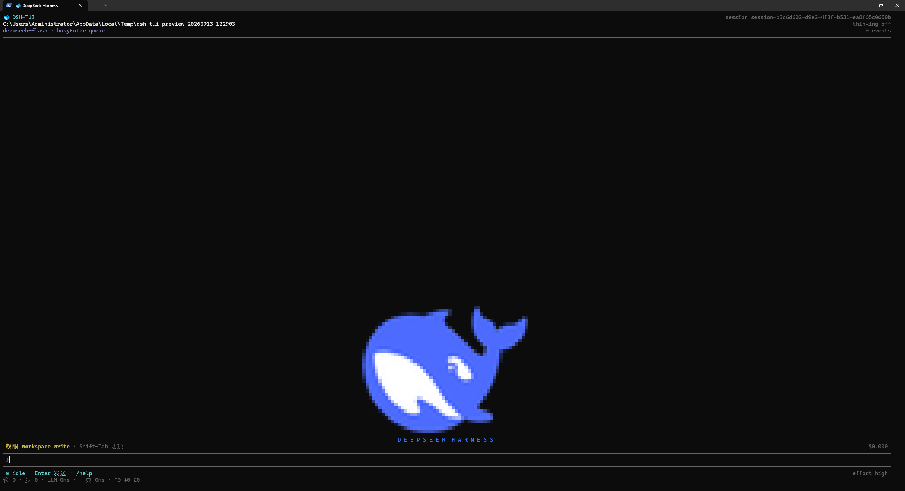
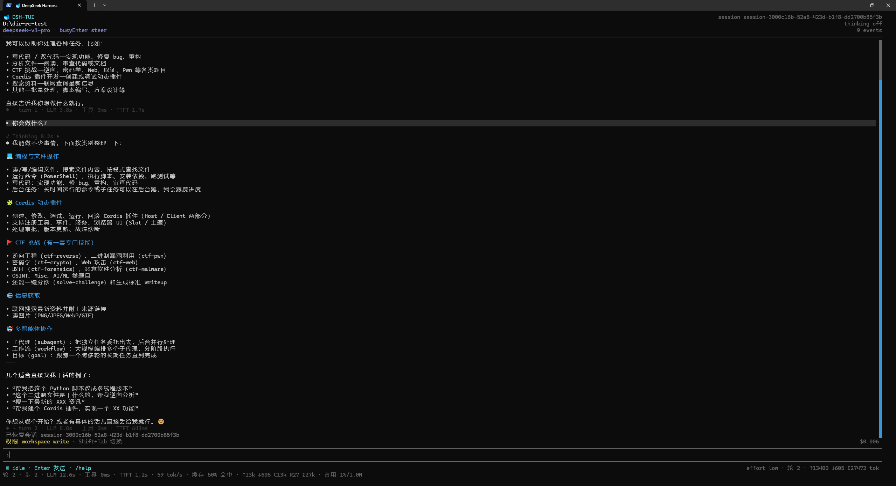

# DSH Terminal UI（`dsh-tui`）

[English](README.md) | 中文

非官方社区维护的 DeepSeek Harness 终端 UI。

<p align="center">
  <a href="#快速开始"></a>
  <a href="https://www.npmjs.com/package/@jame100101/dsh-tui/v/0.2.2"></a>
  <a href="#架构"></a>
  <a href="#架构"></a>
  <a href="#架构"></a>
  <a href="#核心功能"></a>
</p>

<p align="center">本地优先 · 会话持久化 · 工具运行时</p>

> **未发布开发分支**：本地构建仅验证精确官方 Harness `0.2.1-rc.2`。已发布 npm `0.2.2` 面向旧宿主，不能用于验收本分支。请按[隔离安装与验收](README.zh.md#isolated-development)使用本地 tarball；默认 npm `0.2.0-rc.2` 是另一个尚未验证的版本。

这些是已有发布版参考截图，不是本分支的验收截图。

<p align="center">
  
  
</p>

`dsh-tui` 是 DeepSeek Harness agent runtime 的**本地终端助手**，提供类似 Claude Code 的 CLI 和 React 19 + Ink 7 界面，包含思考动画、流式回复、工具卡片、权限、斜杠命令面板、持久会话和设置面板。

<a id="quick-start"></a>

<a id="run"></a>

## 快速开始

### 1. 安装 Node.js 与 npm

本包遵循仓库声明的准确 engine 范围：`^22.19.0 || >=24.0.0`。也就是说，支持 Node.js 22.19.0 及其后的 Node 22 版本、Node.js 24 及更高版本，以及后续满足 `>=24` 的版本。Node 23 和早于 22.19.0 的 Node 22 版本不在声明范围内。

npm 通常会随官方 Node.js 安装包一起安装，不需要单独下载。先检查当前环境：

```sh
node --version
npm --version
```

如果命令缺失或版本不在支持范围内，请按平台选择下面一种安装方式。

#### Windows

**方式 A：官方安装包**

前往 [nodejs.org](https://nodejs.org/en/download) 下载当前 Node.js 安装包，选择满足 Node 22.19+ 或 Node 24+ 的版本。官方安装包会同时安装 npm。

**方式 B：winget**

```powershell
winget install OpenJS.NodeJS.LTS
```

安装后关闭并重新打开 PowerShell 或 Windows Terminal，再检查：

```powershell
node --version
npm --version
where.exe node
where.exe npm
```

#### macOS

已安装 [Homebrew](https://brew.sh/) 时执行：

```sh
brew install node
node --version
npm --version
```

如果机器已有旧版 Node.js，请升级到满足 `^22.19.0 || >=24.0.0` 的版本。需要在多个项目间切换版本时，可以使用 [nvm](https://github.com/nvm-sh/nvm)：

```sh
nvm install 24
nvm alias default 24
nvm use 24
node --version
npm --version
```

#### Ubuntu / Debian

发行版默认 apt 仓库中的 Node.js 可能较旧。即使 `node` 命令存在，也要先检查版本，再安装 `dsh-tui`。

下面是一组可直接复制的 NodeSource Node 24 安装命令：

```sh
sudo apt-get update
sudo apt-get install -y ca-certificates curl
curl -fsSL https://deb.nodesource.com/setup_24.x | sudo -E bash -
sudo apt-get install -y nodejs

node --version
npm --version
which node
which npm
```

对于开发机，推荐使用 nvm 的用户级安装方式，避免系统级 npm 权限问题：

```sh
sudo apt-get update
sudo apt-get install -y curl
curl -o- https://raw.githubusercontent.com/nvm-sh/nvm/v0.40.6/install.sh | bash
source ~/.bashrc
nvm install 24
nvm alias default 24
nvm use 24

node --version
npm --version
which node
which npm
```

如果登录 shell 是 zsh，请将 `source ~/.bashrc` 换成 `source ~/.zshrc`。如果系统已有旧版 apt 或系统 Node.js，请先升级或选择满足要求的版本。

### 2. 安装本地开发 tarball

执行[隔离安装与验收](README.zh.md#isolated-development)中的构建、精确宿主安装和本地 tarball 命令。所有验证使用新临时目录与独立 `DSH_HOME`，不升级全局安装，也不触碰生产会话。

未发布开发包版本为 `0.3.0-rc.1`；npm `0.2.2` 保持为上一版本。profile 包含官方 `@deepseek-ai/dsh-base` 和本地 `@jame100101/dsh-tui`；可选 thin launcher 不会自动进入 shell PATH。

### 3. 启动项目

以下 `dsh` 示例表示上文隔离安装中的官方可执行文件；实际运行时使用验收指南里的完整路径和临时 `DSH_HOME`。

在想要作为 workspace 的目录中启动 `tui` profile。当前目录默认就是 workspace：

```sh
cd your-project
dsh --profile tui
```

启动前设置 DeepSeek API key。Bash、zsh 和 PowerShell 示例：

```sh
export DEEPSEEK_API_KEY=your_api_key
dsh --profile tui
```

```powershell
$env:DEEPSEEK_API_KEY = "your_api_key"
dsh --profile tui
```

请尽量不要把 API key 写入源代码或 shell 历史。

也可以在 TUI 内输入凭据：

1. 输入 `/settings`，按 `Tab` 切到 **Models** 页面。
2. 在 **API credentials** 中选择 DeepSeek 凭据并按 **Enter**。
3. 输入 key（输入框会遮蔽内容且不回显），按 **Enter** 确认。

凭据保存在选定的 `$DSH_HOME` 中。官方 base 策略优先使用保存的凭据，再回退到环境变量和 `.env`。界面显示不含值的来源信息；隔离官方服务测试已验证保存文件、进程、项目环境和用户环境的优先级。真实账号联调与未知密钥格式仍需单独验证。

## 常用命令

| 命令 | 作用 |
| --- | --- |
| `dsh --profile tui` | 在当前目录启动 TUI。 |
| `dsh --profile tui "<task>"` | 启动 TUI 后立即提交任务。 |
| `dsh --profile tui -c` / `--continue` | 恢复当前目录最近的会话。 |
| `dsh --profile tui -r` | 打开交互式会话选择器。 |
| `dsh --profile tui -r <session-id>` | 按 ID、ID 前缀或标题恢复会话。 |
| `dsh --profile tui -c --fork-session` | 从恢复会话最后一个已完成轮次创建分叉。 |
| `dsh --profile tui -p "<task>"` | 不打开 TUI，将单个任务结果输出到 stdout。 |
| `dsh --profile tui -c -p "<task>"` | 恢复会话后以非交互方式执行一个任务。 |
| `dsh --profile tui --version` | 输出兼容的官方 TUI host 版本。 |
| `dsh --profile tui --help` | 显示 CLI 选项。 |
| `/help` | 在 TUI 中显示交互式命令。 |
| `/new` | 创建新会话。 |
| `/resume` | 浏览并恢复已保存的会话。 |
| `/settings` / `/config` | 打开设置（`/config` 是别名）。 |
| `/jobs` / `/tasks` | 查看当前所属会话的后台任务（`/tasks` 仅是 jobs 别名）。 |
| `/export` | 将当前保留的脱敏显示投影导出为文本。 |
| `/export --raw` | 显式导出完整的宿主原始会话 ZIP，可能包含敏感数据。 |
| `Ctrl+R` | 搜索输入历史；Escape 恢复草稿。 |
| `@path` | 在光标处补全工作区文件引用，支持句中引用。 |
| `/keymap legacy-dsh` / `/keymap claude-fullscreen` | 显式选择键位；现有 profile 默认保留 legacy。 |
| `Ctrl+L` | 重绘终端并保留草稿；Claude 键位下 2 秒内双按创建新会话。 |
| `/clear` / `/clear-screen` | 分别创建新会话、只重绘屏幕，均保留输入草稿。 |
| `/source [callId]` | 分页查看完整脱敏工具记录；n/p 翻页，e 导出。 |
| `/session-source` | 查看包含已淘汰展示行的完整脱敏会话记录。 |
| `/send-child <id> queue\|steer <text>` | 向可继续的直属子代理发送人工消息；回执仅表示已准入。 |
| `Ctrl+Z`（POSIX） | 归还终端并挂起；由 shell 的 `fg` 恢复原草稿。 |
| `Ctrl+_` / `Alt+U` | 撤销、重做完整草稿快照；也可用 `/draft undo`、`/draft redo`。 |
| `Alt+B/F`、`Ctrl+Left/Right` | 按词移动，不拆分字素。 |
| `Ctrl+W`、`Alt+Backspace`、`Ctrl+U/K`、`Ctrl+Y` | 删除词或行片段，恢复删除缓冲（也可用 `/draft yank`）。 |
| `/editor` | 用显式配置的 VISUAL 或 EDITOR 编辑草稿；GUI 编辑器需要等待退出参数。 |
| `/effort` | 选择思考强度。 |
| 连按两次 `Ctrl+C` | 退出 TUI。 |

显示脱敏仅采用有限的匹配规则，不能保证移除所有秘密，也不会修改宿主持久化历史。分享前请检查导出内容。默认文本仅包含当前保留的显示行；需要完整宿主归档时才显式使用 raw 选项。此处功能说明不代表全部终端实机验收已通过。设置 Plugins 页可输入精确版本并二次确认更新 profile 所有的第三方 bundle；官方宿主返回待重启时，明确区分安装与加载版本。HMR 不支持替换时显示真实失败，不绕过宿主。设置 `DSH_TUI_REDUCED_MOTION=1` 可关闭装饰动效，`TERM=dumb` 自动采用该模式。

退出码：`0` 表示成功，`1` 表示 runtime 失败，`2` 表示用法错误，`130` 表示 SIGINT。`--print` 只将 agent 结果写入 stdout，诊断信息写入 stderr。

## 核心功能

- **本地优先 TUI：** 直接运行在终端中，而不是托管网页中。
- **流式 agent 交互：** 实时显示思考、回复、工具活动、权限和状态。
- **持久会话：** 恢复历史对话、浏览记录、重命名会话，并在不覆盖原会话的情况下分叉。
- **Print 模式：** `-p` 生成适合 shell 和 CI 的干净、可脚本化输出。
- **斜杠命令面板：** 输入 `/` 搜索命令，`Tab` 补全，`Esc` 关闭。
- **设置：** 提供 General、带 API credentials 的 Models、Plugins、Inventory 和 agent Presets 页面。
- **工具与权限：** bash、PowerShell、文件和 Web 工具通过 sandbox-mode 栏运行，并支持审批和 ask-user 交互。
- **响应式终端布局：** 处理 resize、alternate-screen 生命周期、鼠标滚轮、选择和滚动条交互。
- **Unicode 显示：** composer 和会话记录支持 CJK、emoji 以及 ⚙ 等符号。
- **持久 Shell 启动：** 官方 Harness 让持久 Shell 工具和终端读取器共用同一个 prompt sentinel，`pwd`、`ls` 等短命令不会因暗号不一致而等待 fallback 超时。
- **插件分发：** TUI 作为 profile bundle 安装到兼容的官方 Harness 上，不再复制 Harness runtime。

## 常见故障

### 旧安装与回退

保留旧宿主、旧插件和原 `DSH_HOME`。本分支采用并行隔离安装，不要求卸载全局包、重建生产 profile 或迁移旧会话。详细回退及数据保护步骤见[验收指南](README.zh.md#isolated-development)。

### `node: command not found` 或 Windows 提示 `'node' is not recognized`

安装 Node.js 后重新打开终端。如果问题仍在，请确认 Node.js 已安装且安装目录位于 `PATH`：

```sh
which node
which npm
```

Windows 使用：

```powershell
where.exe node
where.exe npm
```

### `npm: command not found`

npm 通常由 Node.js 安装包提供。请修复或重新安装 Node.js 及其 PATH 配置，不要单独下载 npm。

### `dsh: command not found`

检查 npm 全局前缀和可执行文件位置：

```sh
npm prefix -g
which node
which npm
which dsh
```

Windows 使用：

```powershell
npm prefix -g
where.exe node
where.exe npm
where.exe dsh
```

如果全局 bin 目录不在 PATH 中，请将 npm 报告的目录加入 PATH，或使用 nvm 等用户级 Node 版本管理器。

### `dsh-tui: command not found`

执行 `dsh plugin --profile tui add` 后出现该结果符合预期：plugin manager 会把 package bin 保留在 profile 内，不会暴露到 shell `PATH`。请使用 `dsh --profile tui` 启动。

### Node.js 版本过低

运行 `node --version`，升级到声明范围 `^22.19.0 || >=24.0.0`。Node 22.0–22.18 和 Node 23 不属于本包支持的 engine 范围。

### Linux 或 macOS 全局安装出现 EACCES

优先使用 nvm 或其他用户级 Node.js 安装，让 npm 全局前缀由当前用户写入。不要把 `sudo npm install -g ...` 作为默认修复方式，否则可能在 npm 前缀中产生混合所有权。

## 发布状态与维护

本分支未发布、未合并 main，也未改动 npm dist-tag 或 GitHub Release。已发布 `0.2.2` 与本地开发包不可互换；新候选包已使用独立版本和文件名。验收使用精确 tarball，不使用 npm `latest`。

会话、凭据和配置由官方宿主管理。不要删除整个生产 home，也不要自动执行 `--from-default-profile` 重建。配置来源、精确版本、回退和人工验收边界见[开发验收指南](README.zh.md#isolated-development)。

## 开发

<a id="run-from-source"></a>

本仓库现在是 standalone out-of-tree plugin repo，不再 vendoring/syncing 完整 Harness 源码。后续 Harness 更新采用 dependency upgrade + adapter compatibility，而不是 upstream merge。

```sh
git clone https://github.com/jame100101/dsh-terminal-ui.git
cd dsh-terminal-ui
pnpm install --frozen-lockfile
pnpm run build
pnpm run typecheck
pnpm run test
pnpm run verify:repo
pnpm run test:docs
pnpm run dsh-tui:pack-plugin
```

TUI 源码位于 `packages/tui/tui`；`apps/tui-cli` 保存薄 launcher、bundle patch、打包脚本与官方 clean-room 验证器。构建结果通过官方 dsh 安装本地 tarball 验证，不运行仓库内的 Harness CLI。中英文文档同步维护。

## 架构

- **React 19 + Ink 7：** 负责终端渲染和输入处理。
- **TypeScript：** 提供类型化的应用和插件代码。
- **DeepSeek Harness runtime：** 提供会话、工具、权限、持久化和 agent loop 等基于插件的服务。
- **持久终端工具：** Shell 与文件系统操作通过 Harness runtime 执行。
- **会话存储：** 本地持久化支持恢复和历史浏览。

```text
dsh-tui (CLI wrapper, apps/tui-cli)
  → official @deepseek-ai/dsh launcher
  → Cordis plugin composition (profile: tui)
  → React + patched Ink TUI plugin (@jame100101/dsh-tui)
  → event-sourced session log → live transcript rows
```

wrapper 负责转换启动参数并运行 `dsh --profile tui`。TUI 插件将 append-only session log 折叠为用户、agent、思考、工具卡片、重试和状态等记录；TTY 使用 patched Ink 全屏渲染器，pipe 和 CI 使用逐行 fallback。

如需逐项比较 Web 前端，请参阅 **[TUI-WEB-COMPARISON.md](TUI-WEB-COMPARISON.md)**。

参阅 [docs/architecture.zh.md](docs/architecture.zh.md) 了解仓库架构，参阅 [packages/README.zh.md](https://github.com/jame100101/dsh-terminal-ui/blob/f2fddbe1cdc56762a2bf14a5a657db11c7d26bbf/packages/README.zh.md) 了解包分组。

<a id="isolated-development"></a>

## 隔离开发

本分支尚未发布。开发包版本为 `0.3.0-rc.1`；npm 上的 `@jame100101/dsh-tui@0.2.2` 是面向 Harness `0.1.5-rc.3` 的不同产物。请使用下面的本地 tarball 配合精确官方版本 `0.2.1-rc.2`。请使用固定版本，不依赖可变 npm 标签。

## 后续优先使用源码验收

重复使用现有隔离验收 home，不再每个修订版新建 home：

```sh
DSH_TUI_ACCEPTANCE_HOME=/absolute/existing/isolated/home pnpm dev:tui
```

入口针对固定 rc.2 构建当前源码，仅首次初始化独立的 `tui-source` profile，继续使用同一份凭据与会话。要求已有 `tui` profile，不修改全局安装。回退时先关闭它，再使用旧启动入口。macOS Terminal 粘贴截图请按 **Ctrl+V**；Cmd+V 可能不发送任何输入事件。参见功能对照与限制（验收记录单独保存在仓库外）。

## 构建与自动检查

在本 checkout 中使用 Node `^22.19.0 || >=24.0.0` 和 pnpm `11.7.0`：

```sh
# Replace this path if the checkout was moved.
cd /Users/apple/.codex/worktrees/claude-tui-parity/dsh-terminal-ui
pnpm install --frozen-lockfile
pnpm build
pnpm typecheck
pnpm test
pnpm verify:repo
pnpm test:docs
pnpm dsh-tui:pack-plugin
pnpm audit:tarball apps/tui-cli/jame100101-dsh-tui-0.3.0-rc.1.tgz
pnpm dsh-tui:verify-plugin apps/tui-cli/jame100101-dsh-tui-0.3.0-rc.1.tgz
```

验证器会创建独立官方安装与 `DSH_HOME`，安装精确 tarball，通过三条启动路径进行 PTY 检查，并验证 Harness/Cordis 身份、patched Ink 与 React 单实例。临时目录会保留并输出路径。这些检查证明打包和启动，不代表真实账号授权或每一种终端环境都已验证。实际执行证据、PASS/FAIL/UNTESTED 及剩余验收项见实施进度（验收记录单独保存在仓库外）。

## macOS 或 Linux 交互验收

打包后在 checkout 中运行。安装仅写入新临时目录，不改变全局 Harness 或生产 home：

```sh
DSH_VALIDATION_TARBALL="$(pwd)/apps/tui-cli/jame100101-dsh-tui-0.3.0-rc.1.tgz"
DSH_VALIDATION_DIR="$(mktemp -d -t dsh-tui-eval.XXXXXX)"
mkdir -p "$DSH_VALIDATION_DIR/host"
node -e 'require("fs").writeFileSync(process.argv[1],JSON.stringify({private:true,overrides:require("./scripts/security-overrides.json")}))' "$DSH_VALIDATION_DIR/host/package.json"
npm install --prefix "$DSH_VALIDATION_DIR/host" --save-exact --no-audit --no-fund @deepseek-ai/dsh@0.2.1-rc.2
DSH_HOME="$DSH_VALIDATION_DIR/home" "$DSH_VALIDATION_DIR/host/node_modules/.bin/dsh" plugin --profile tui add "$DSH_VALIDATION_TARBALL"
NODE_ENV=production DSH_HOME="$DSH_VALIDATION_DIR/home" "$DSH_VALIDATION_DIR/host/node_modules/.bin/dsh" --profile tui
```

验收其他项目时，切换到目标目录，再使用相同变量执行最后一条命令。相对 `@file` 与图片路径使用会话有效目录；更改会话目录不会改变原始项目身份、已有 shell 进程目录或沙箱可写根。

通过 Models 设置页或继承的环境变量配置测试凭据。不要把真实密钥粘贴到报告、截图或 shell 命令历史。本 TUI 使用官方 base 的凭据策略：保存的凭据优先于环境变量与 `.env` 回退。设置页显示宿主报告的来源；官方本地 provider 的来源优先级组合已通过隔离自动化验证。

## Windows PowerShell

在 checkout 打包后运行：

```powershell
$dshValidationTarball = (Resolve-Path 'apps/tui-cli/jame100101-dsh-tui-0.3.0-rc.1.tgz').Path
$dshValidationDir = Join-Path ([IO.Path]::GetTempPath()) ('dsh-tui-eval-' + [guid]::NewGuid().ToString('N'))
New-Item -ItemType Directory -Path $dshValidationDir | Out-Null
New-Item -ItemType Directory -Path (Join-Path $dshValidationDir 'host') | Out-Null
node -e 'require("fs").writeFileSync(process.argv[1],JSON.stringify({private:true,overrides:require("./scripts/security-overrides.json")}))' (Join-Path $dshValidationDir 'host/package.json')
npm install --prefix (Join-Path $dshValidationDir 'host') --save-exact --no-audit --no-fund @deepseek-ai/dsh@0.2.1-rc.2
$dshValidationBin = Join-Path $dshValidationDir 'host/node_modules/.bin/dsh.cmd'
$dshPreviousHome = $env:DSH_HOME
$dshPreviousNodeEnv = $env:NODE_ENV
try {
  $env:NODE_ENV = 'production'
  $env:DSH_HOME = Join-Path $dshValidationDir 'home'
  & $dshValidationBin plugin --profile tui add $dshValidationTarball
  & $dshValidationBin --profile tui
} finally {
  $env:DSH_HOME = $dshPreviousHome
  $env:NODE_ENV = $dshPreviousNodeEnv
}
```

这些 Windows 命令用于 CI/人工验收矩阵；在 macOS 执行测试不能证明 Windows Terminal、ConPTY、SSH 或 tmux 兼容性。

## 人工检查与回退

检查历史、补全、设置和发送拒绝后的草稿；流式生成时浏览旧记录；取消待处理审批与问答；恢复、分叉隔离会话；查看失败和停止的任务；检查多 hunk diff。确认中文/Emoji 编辑、窄窗口缩放和退出后的终端恢复。按 F01–F35/UI-01–UI-15 记录，未执行项保持 UNTESTED。

官方 Agent loop、持久化与权限仍是事实来源。PTC 使用官方 Node runtime。Native/PTC 工具暴露、Plan、权限和预设是不同概念。依赖浏览器的调度工具在终端预设中明确禁用，不宣传为可用。预设通过 `dsh-agent-preset-registry` 与 `dsh-agent-preset` 声明，不再扫描旧 `.agent-presets` 目录。

回退方式是关闭验收进程，用原来的 home 启动未改变的旧安装。证据采集完成前保留验收目录。不需要复制会话或迁移生产数据。不要将 alpha 指向生产 `DSH_HOME`、把 `--from-default-profile` 当升级捷径、重写会话 JSONL、清空凭据/设置或覆盖最后可用安装。已有发布版本与 tags 均保持不变。如果后续工作依赖本分支提交，应在另一个临时分支做 revert；原 main checkout 始终保留。

验收新增命令：`/config`、仅为 jobs 别名的 `/tasks`、Ctrl+R 历史搜索和句中 `@path` 补全。对照 `/export` 保留的脱敏显示文本与 `/export --raw` 完整宿主原始 ZIP；脱敏匹配规则有限且不会修改宿主历史，分享前检查内容。

## 后续检查

使用 `/source` 和 `/session-source` 查看完整脱敏记录；`/export` 仍只导出有限展示投影。测试双按 Ctrl+L 前需显式选择 `/keymap claude-fullscreen`。插件版本更新只在隔离 profile 中测试；待重启结果不代表新代码已经加载。`/send-child <id> queue|steer <text>` 使用官方直属父代理授权。设置 `DSH_TUI_REDUCED_MOTION=1` 可减少动效；POSIX Ctrl+Z/`fg` 保留草稿。自动化与实机验证范围以最新验收账本为准。

外部编辑需要显式设置 VISUAL 或 EDITOR 可执行文件，可带引用参数，不解释 shell 语法。`/editor` 暂停 Ink，等待子进程退出；非零退出、取消、图片引用标记被改动或会话切换时保留原草稿。临时文本文件为私有权限，子进程关闭后清理。撤销、重做和删除缓冲保留附件身份与长粘贴块，并在切会话时重置。

## 外观和输入

使用 `/theme claude-terminal-dark` 或 `/theme claude-terminal-light`。旧的 `dsh-classic` 配置只映射为当前深色主题，不能选择旧界面。字体和字号由终端应用控制；输入栏从启动起采用稳定的块状光标。

<a id="mcp-and-keybindings"></a>

## MCP 与快捷键

当前开发分支兼容官方 Harness **0.2.1-rc.2**。继续使用固定源码启动入口与原隔离 home，不创建新凭据库。

## MCP

`/mcp` 打开设置的 MCP 页。显示官方 Loader 启停、加载状态，以及当前 Agent 可见工具；这些事实**不等于连接健康**。官方客户端断线重连时可能保留工具，PTC 模式也会改变可见工具 schema。rc.2 未公开可供本 TUI 调用的 OAuth 登录和连接健康状态接口。

先在绝对路径创建本地 JSON，例如：

```json
{
  "serverName": "local",
  "transport": "stdio",
  "command": "/absolute/path/to/node",
  "args": ["/absolute/path/to/server.mjs"],
  "env": {},
  "failOnStartupError": true
}
```

HTTP 配置使用 `"transport": "streamable-http"`、`"url": "https://example.org/mcp"` 和可选 `"headers": {}`，替换 command/args/env。可设置官方的 reconnect、toolCallTimeoutMs。参数交由官方客户端直接执行，不经过 TUI shell 拼接；不移植其他后端的旧 SSE/WebSocket 传输。

命令：

- `/mcp add /absolute/server.json`：添加默认**禁用**的 `mcp-<serverName>`。
- `/mcp enable mcp-local` / `/mcp disable mcp-local`：启用/禁用。
- `/mcp reconnect mcp-local`：卸载后重新加载官方客户端；禁用时需先启用。
- `/mcp update mcp-local /absolute/server.json`：更新本界面创建的服务器，serverName 保持一致；更新后保持禁用，需明确启用。
- `/mcp remove mcp-local`：停止并移除本界面创建的条目；其他来源条目仍由原配置管理。

重复相同命令确认；MCP 可选行同样需要第二次 Enter。操作与插件切换共用串行队列，存在运行/排队 Agent 时拒绝修改，操作中阻止新的 TUI 请求进入。切换选项/会话撤销行确认；退出会等待已接纳的补丁写入收尾，再请求宿主关闭。启用和重连会运行外部程序或连接服务器。新增/更新的凭据保存在权限 0600 的 profile 补丁文件，不进入聊天记录；原始 JSON 需自行保护。不要在命令中粘贴 Token。MCP 配置不进入通用明文设置编辑器。

原子修改保留周围注释与 `!!js`。应用失败只在没有其他写入者修改文件时恢复本次文本。重连失败可能保持禁用；修正原因后在 `/mcp` 检查并启用。移除/更新仅操作 TUI 创建的区块，不自动安装 npm 包，不伪造 OAuth 登录。

## 自定义快捷键

`/keybindings` 显示**当前 profile** 的 `keybindings.json` 路径、校验错误及重复/前缀冲突警告。它与主题、legacy/Claude 默认键位分离。自行创建文件，约 500ms 热加载；无效编辑保留最后有效配置，删除文件恢复默认，退出时清理 watcher。

```json
{
  "bindings": [
    {
      "context": "Chat",
      "bindings": {
        "ctrl+x ctrl+s": "chat:submit",
        "ctrl+j": "chat:newline",
        "enter": null
      }
    },
    {
      "context": "Global",
      "bindings": { "ctrl+x ctrl+l": "app:clear" }
    }
  ]
}
```

Chat 优先于 Global，同上下文后定义覆盖先定义。支持两段组合键，前缀一秒超时；Esc 取消前缀，未匹配尾键恢复正常输入。粘贴/IME 整段输入不拆成快捷键。null 消费显式解绑按键。动作保留原编辑语义：app:clear 仍遵循所选默认键位的重绘/双按清会话规则，chat:stash 需要 claude-fullscreen。

支持动作：chat:submit、chat:newline、chat:cancel、chat:historySearch、chat:stash、chat:paste、chat:undo、chat:redo、chat:yank、chat:deleteWordBackward、chat:deleteToLineStart、chat:deleteToLineEnd、chat:lineStart、chat:lineEnd、chat:cycleMode、app:clear、app:exit。

修饰键支持 ctrl、shift、alt/meta/option、cmd/super；名称支持 enter、escape、tab、backspace、delete、up/down/left/right、home/end、pageup/pagedown。终端/操作系统仍可能截获按键。Ctrl+C 保留给复制/中断；审批、问答、设置和密钥编辑区保留固定键位，Global 不覆盖这些保护区。未知动作/上下文报错，不假装可用。文件最多 64KiB、256 条规则。完整 Claude 动作/上下文覆盖与 Vim 仍是独立差距。

## 参考与验证边界

功能参考 [ccch1mneyyy/dsh-TUI](https://github.com/ccch1mneyyy/dsh-TUI)，版本 `75954c04c3bdd43010f24d7f1d58ac5f3d94472f`，核对能力判断和重连/切换分发。配置形式参考 [Claude 快捷键文档](https://code.claude.com/docs/en/keybindings)。另审查 [open-claude-code](https://github.com/ruvnet/open-claude-code)，版本 `1c2aaf2c610185f916aacac2a79c73ecd1a12c13` 的 `v2/src/mcp/client.mjs`；其独立协议/传输不能替代 Harness 当前 SDK。本轮未复制参考运行时或 Claude 私有实现，保留 React/Ink 和官方 Agent Loop。

实际执行证据见 实施进度（验收记录单独保存在仓库外），剩余差异见 技术审查（验收记录单独保存在仓库外）。原生终端 IME/快捷键传递以及实际 OAuth/服务商账号不由脚本测试替代。

面板动作：`app:settings`、`chat:model`、`chat:permissions`、`chat:sessions`、`chat:background`。通过已有 Adapter 命令执行，保留草稿，不向模型提交。受保护面板仍使用固定按键，不新增默认 Ctrl+B。

## 面板导航上下文

`Settings` 和 `SessionPicker` 支持 `panel:up`、`panel:down`、`panel:pageUp`、`panel:pageDown`、`panel:close` 或 null。这里不能执行 Chat/Global 动作；Global 不覆盖面板按键。审批/提问、凭据与值编辑、权限确认和插件安装确认继续受保护。导航不新增批准动作快捷键。示例：`{"bindings":[{"context":"Settings","bindings":{"ctrl+n":"panel:down","ctrl+p":"panel:up"}}]}`。

发布审查、阶段进度与验收截图保存在仓库外；只将产品说明保留在 README。测试与负载工具仍在仓库中，发布验收报告写到仓库外。

## 权限默认值与第三方插件包

权限页区分当前会话权限组合、审批策略和新会话默认权限。更改默认值需要确认，当前和旧会话保持不变；只提供 Harness 目录允许的默认值，实验性 Auto 不可作为默认值。Harness rc.2 没有通用 allow/deny 规则编辑 API。

插件页接受 `example-bundle@1.2.3` 等精确 registry 版本，经审阅和确认后安装；新包默认禁用，需另行确认启用。宿主、TUI 运行时和安装目录自带包受保护。不会自动授予构建脚本或版本兼容豁免。界面区分已应用、失败和待重启；Esc 不会取消已启动的安装。替换已安装版本可能需要停止 profile 后使用官方 CLI。

直接运行官方 `dsh` 前须设置 `NODE_ENV=production`（PowerShell：`$env:NODE_ENV = "production"`）。`pnpm dev:tui` 与薄启动器只为其子进程设置该值。

只有宿主标记可移除的插件包才显示移除操作；移除需要独立确认，并重新核验当前 profile 归属。

运行 `pnpm test:load:release` 可执行一小时隔离官方宿主负载：32 KiB 工具结果并反复切换会话。测试使用合成 provider，要求后段 RSS 稳定及存活 Agent/Session 数量受限；失败或证据不足均以非零状态退出。报告默认写入打印出的仓库外临时目录，也可用 `DSH_HOST_SOAK_REPORT` 指定仓库外绝对路径保存。这不能替代真实账号或原生终端验收。
