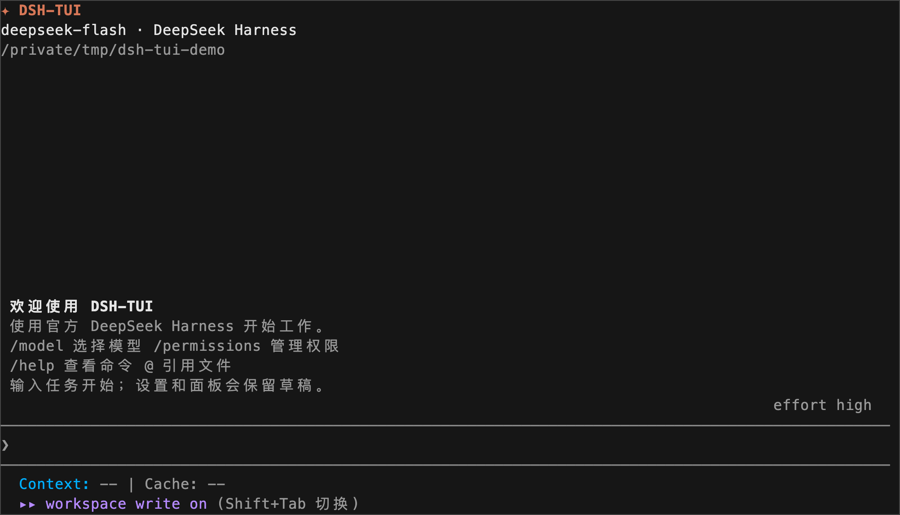
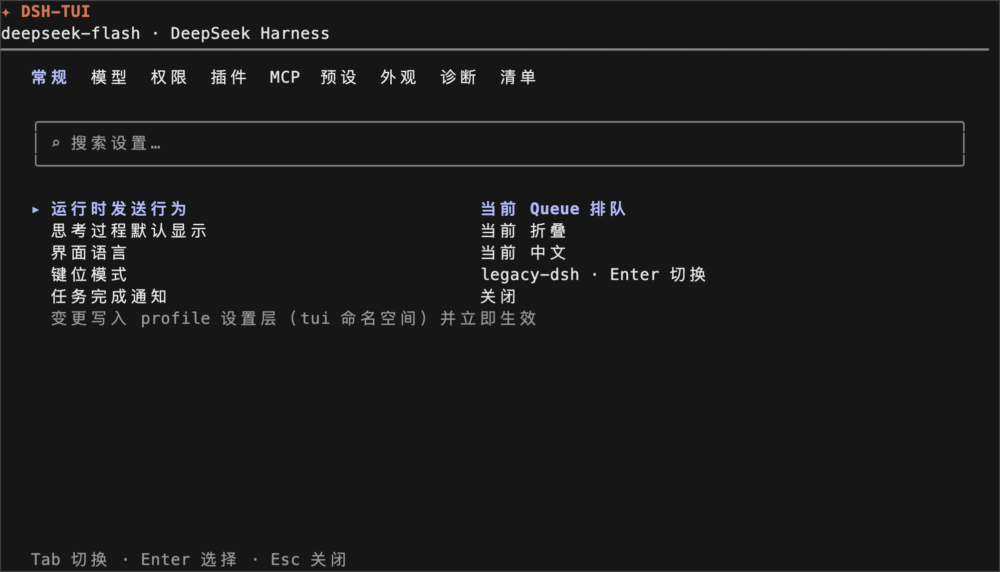

<h1 align="center">DSH Terminal UI</h1>

<p align="center"><strong>A Claude Code-inspired terminal frontend for DeepSeek Harness</strong></p>

English | [中文](README.zh.md)

`@jame100101/dsh-tui` adds a Claude Code-inspired React and Ink terminal interface to an official DeepSeek Harness profile. The optional `dsh-tui` command is a thin argument translator for `dsh --profile tui`; session, agent, tool, and persistence services come from the official Harness installation.

## Version

The source version is **`1.0.0`** (GitHub tag `v1.0.0`); it has not been published to npm.

`0.3.0-rc.1` is published under npm `next` and requires official Harness **`0.2.1-rc.2`**. The older `latest` package (`0.2.2`) targets a different host. With a compatible official installation:

```sh
dsh --version
dsh plugin --profile tui add @jame100101/dsh-tui@0.3.0-rc.1
dsh --profile tui
```

Reuse the same `DSH_HOME` to retain credentials and sessions; do not rebuild an existing profile from defaults. For a fresh or isolated host, follow the [repository installation guide](https://github.com/jame100101/dsh-terminal-ui#isolated-development). Bundle order is `@deepseek-ai/dsh-base`, then `@jame100101/dsh-tui`. Only patched Ink is bundled; Harness stays external and Ink/TUI share React.

Current UI, captured from an isolated official-host PTY and replayed as terminal cells (not a native Terminal window screenshot).





## Thin launcher

The packaged `dsh-tui` bin forwards the existing command grammar to compatible official Harness `0.2.1-rc.2`. It resolves npm global and local `dsh` entries on `PATH`, including POSIX symlinks and Windows command shims, or accepts the official JavaScript entry through `DSH_BIN`. It does not install, upgrade, or modify Harness or the profile. This advanced launcher is available only when an environment deliberately exposes the package bin; installing the plugin globally for that purpose is not recommended because npm installs another Harness and Cordis dependency tree.

```text
dsh-tui                          interactive TUI, new session
dsh-tui "fix the failing test"   interactive TUI, submits the task on boot
dsh-tui -c                       resume the most recently used session from this directory
dsh-tui -r                       interactive session picker
dsh-tui -r <session>             resume by id, id prefix, or title
dsh-tui -c --fork-session        fork the resumed session, then switch to it
dsh-tui -p "run the tests"       one-shot: print the assistant result and exit
dsh-tui -c -p "keep going"       resume, then run one task non-interactively
```

Exit codes are `0` for success or the official Harness supervisor-stop result from SIGTERM, `1` for an execution failure, `2` for a usage error, and `130` for SIGINT. SIGTERM remains `0` because official Harness treats it as an ordinary supervised shutdown on every application surface. `--print` writes the assistant result to stdout and diagnostics to stderr.

If no compatible official Harness is present, the launcher names the required package version. Before boot, it resolves the Harness home through the compatible official installation and reports a missing plugin when the profile does not contain it. After an interactive child exits, it resets mouse tracking, bracketed paste, cursor visibility, the alternate screen, and SGR state.

## Verification

The clean-room verifier installs official Harness outside this repository, creates an isolated `DSH_HOME`, installs the packed plugin, checks package identity and patched Ink resolution, and boots direct dsh plus launcher paths using explicit `DSH_BIN` and npm's PATH entry under a PTY:

```sh
node apps/tui-cli/scripts/verify-official-plugin.mjs apps/tui-cli/jame100101-dsh-tui-1.0.0.tgz
```

It leaves the temporary install and `DSH_HOME` in place and prints both paths for inspection.

## Build from source

Development builds may assemble and pack the plugin from a repository checkout:

```sh
npm run dsh-tui:pack-plugin
```
