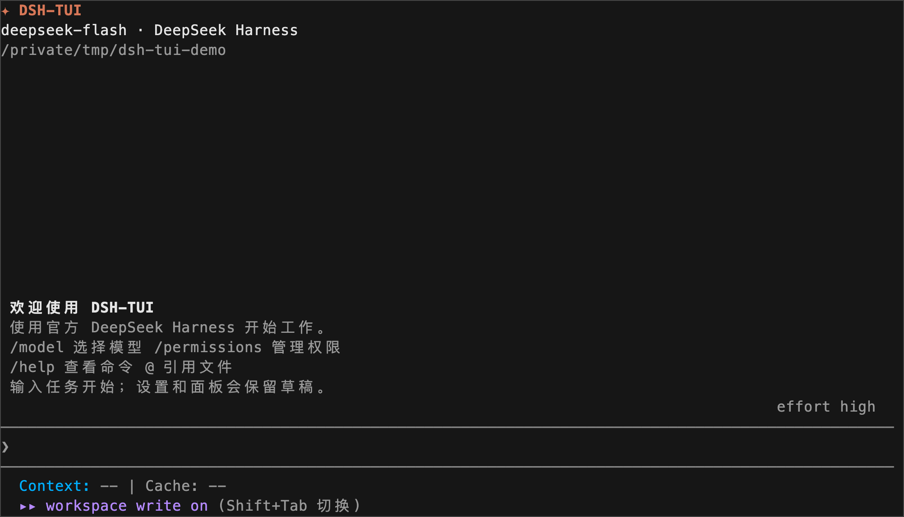
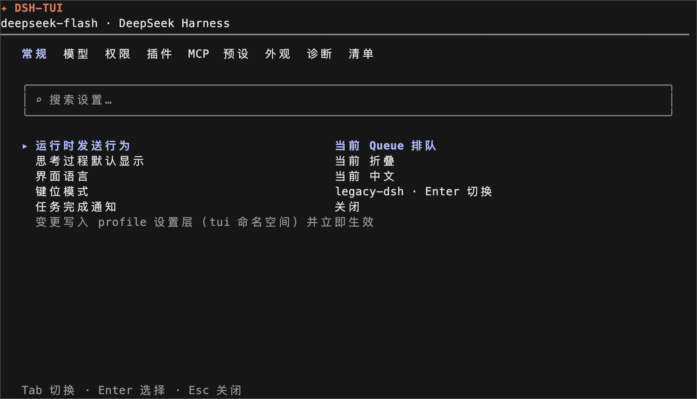

<h1 align="center">DSH Terminal UI</h1>

<p align="center"><strong>参考 Claude Code 风格的 DeepSeek Harness 终端前端</strong></p>

[English](README.md) | 中文

`@jame100101/dsh-tui` 为官方 DeepSeek Harness profile 添加参考 Claude Code 视觉与键盘交互风格的 React 和 Ink 终端界面。可选的 `dsh-tui` 命令只把参数转换后交给 `dsh --profile tui`；会话、agent、工具和持久化服务来自官方 Harness 安装。

## 发布候选

`0.3.0-rc.1` 已发布至 npm `next`，需要官方 Harness **`0.2.1-rc.2`**。旧版 `latest`（`0.2.2`）对应不同宿主。已有兼容官方安装时：

```sh
dsh --version
dsh plugin --profile tui add @jame100101/dsh-tui@0.3.0-rc.1
dsh --profile tui
```

沿用同一 `DSH_HOME` 保留凭据和会话，不要从默认配置重建已有 profile。新宿主或隔离安装请参阅[仓库安装指南](https://github.com/jame100101/dsh-terminal-ui/blob/main/README.zh.md#isolated-development)。profile bundle 顺序为 `@deepseek-ai/dsh-base`、`@jame100101/dsh-tui`。包只捆绑 patched Ink，Harness 保持外部依赖，Ink/TUI 共享 React。

新版界面来自隔离官方宿主 PTY 的单元格重放，并非原生 Terminal 窗口截图。





## Thin launcher

包内的 `dsh-tui` bin 把原有命令参数转发给兼容的官方 Harness `0.2.1-rc.2`。它能从 `PATH` 解析 npm global 和 local `dsh` entry，包括 POSIX symlink 与 Windows command shim，也可通过 `DSH_BIN` 指定官方 JavaScript entry。它不会安装、升级或修改 Harness 或 profile。只有环境主动暴露 package bin 时才能使用这个 advanced launcher；不建议为此全局安装 plugin，因为 npm 会再安装一套 Harness 和 Cordis dependency tree。

```text
dsh-tui                          interactive TUI, new session
dsh-tui "fix the failing test"   interactive TUI, submits the task on boot
dsh-tui -c                       resume the most recently used session from this directory
dsh-tui -r                       interactive session picker
dsh-tui -r <session>             resume by id, id prefix, or title
dsh-tui -c --fork-session        fork the resumed session, then switch to it
dsh-tui -p "run the tests"       one-shot: print the assistant result and exit
dsh-tui -c -p "keep going"       resume, then run one task non-interactively
```

退出码为：成功或 official Harness 收到 SIGTERM 后的 supervisor-stop 结果 `0`、执行失败 `1`、用法错误 `2`、SIGINT `130`。SIGTERM 保持为 `0`，因为 official Harness 在所有 application surface 上都把它视为普通的 supervised shutdown。`--print` 把助手结果写到 stdout，把诊断写到 stderr。

缺少兼容的官方 Harness 时，launcher 会指出所需包版本。启动前，它通过兼容的官方安装解析 Harness home，并报告 profile 缺少插件。交互 child 退出后，它会复位 mouse tracking、bracketed paste、光标可见性、alternate screen 和 SGR 状态。

## 验证

Clean-room verifier 会在仓库外安装官方 Harness、创建隔离的 `DSH_HOME`、安装 packed plugin、检查包 identity 和 patched Ink 解析，并在 PTY 中分别通过 direct dsh、显式 `DSH_BIN` launcher 和 npm PATH entry launcher 启动：

```sh
node apps/tui-cli/scripts/verify-official-plugin.mjs apps/tui-cli/jame100101-dsh-tui-0.3.0-rc.1.tgz
```

验证器会保留临时安装和 `DSH_HOME`，并输出两个路径供检查。

## 从源码构建

开发时可以从 repository checkout 组装并打包 plugin：

```sh
npm run dsh-tui:pack-plugin
```
